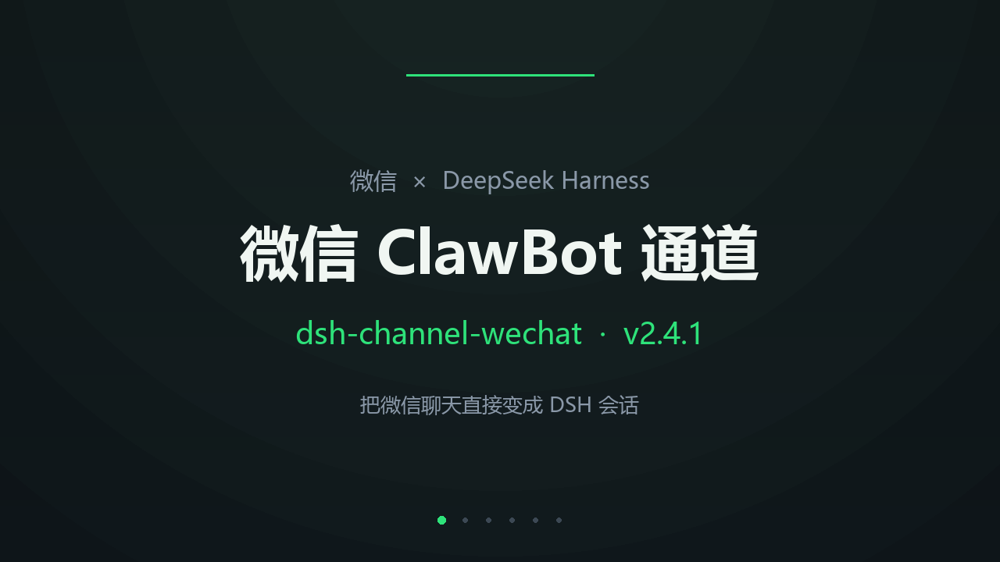

# 微信 ClawBot（iLink）通道 · DeepSeek Harness 插件

**中文** | [English](./README.en.md) · 版本 **2.4.0** · [更新日志](./CHANGELOG.md)

把 **DeepSeek Harness 的会话**和**微信（官方 ClawBot「龙虾」插件）**双向接起来：
微信里发消息 → 变成 DSH 会话里的用户消息；DSH 会话里的回复 → 发回微信。
支持多账号、每条微信聊天可绑定到任意一个 DSH 会话、Web GUI 里有一块专门的面板。

[](./docs/promo.mp4)

> 14 秒宣传片：[MP4 下载](./docs/promo.mp4) · [GIF](./docs/promo.gif)（点封面也能播）

> 不依赖 OpenClaw。微信 ClawBot 背后是腾讯的 iLink Bot 协议（HTTP/JSON），本插件直接实现它。

## 功能

- **双向镜像**：微信 ↔ 指定 DSH 会话。微信消息注入会话（GUI 里实时可见），助手的回复自动回微信；GUI 里输入的消息带 `[网页]` 前缀转发到微信。
- **多账号**：多个微信号（bot）同时在线，各自独立长轮询、独立游标、独立错误状态；单个账号可重扫码/断开而不影响其它账号。
- **绑定面板**：左侧栏「微信」→ 账号表（状态/最近错误/重扫码/断开）、扫码登录区（二维码 + 数字配对码）、绑定表（chat → 会话下拉框，选完立刻生效，可解绑/直接打开会话）。顶部还有「默认接收会话」选择器，决定以后新出现的微信聊天默认落到哪个会话，并可一键「新建会话并设为默认」。
- **发文件**：本地图片 / 视频 / 任意附件 → AES-128-ECB 加密 → 腾讯 CDN → 微信（图片走 `image_item`、视频走 `video_item`、其它走 `file_item`；单文件上限 50 MB）。
- **排版优化**：发到微信前统一把 Markdown 转成窄屏友好文本——表格变 · 键：值、标题变 【】、勾选框变 ✅/⬜、长段落按句读断行（列表续行缩进），宽度由 ormatMaxLine 控制。
- **任务进度播报**：wechat_report 把「标题 + 勾选清单（✅/🔄/⬜/⛔/⚠️）+ 备注」渲染成一条微信消息推给指定聊天；token 过期时自动进发送队列等补发。
- **跨账号转发**：多个微信号绑定同一个会话时，A 号收到的消息会自动转发到 B/C 号的微信（带 `[{account}] ` 前缀，可配 `relayPrefix`）；助手的回复本来就按绑定分别送达，所以三个号看到的是同一段对话。
- **微信引用**：在微信里长按「引用」某条消息（含只选中一段）再发问时，被引用的原文会以 `【引用】…` 的形式一起进入模型上下文。插件维护最近 800 条收发消息的引用库（`quotes.json`），客户端只给 `svr_id` 时也能按 id 还原原文，再按 `startindex/endindex` 截取选中片段。
- **选项 / 审批在微信里作答**：DSH 弹出 `ask_user_question` 选项卡或审批卡时，插件会把题目和选项同步发到绑定的微信：回序号（`1`、`1,3`）或直接回文字即可作答；审批回 `1`（允许一次）/ `2`（拒绝）。微信里等不到回复（默认 110 秒）就把这次请求交还电脑端弹卡，不会把会话卡死。由 `relayOptions` / `optionReplyTimeoutMs` 控制。
- **长任务进度提示**：绑定会话的一轮跑得久时，每隔 `progressIntervalMs`（默认 2 分钟）在微信里发一条「⏳ 还在处理：已经思考 X 分 Y 秒（第 N 次进度）」；如果这时正在等你回选项，会改成「⌛ 在等你回复：已经等了 X 分」。轮次结束自动停，不会刷屏。
- **Agent 工具**：`wechat_login` / `wechat_verify_code` / `wechat_status` / `wechat_bind` / `wechat_unbind` / `wechat_send` / `wechat_send_file` / `wechat_report` / `wechat_logout` / `wechat_simulate` / `wechat_debug`。

## 安装

要求：DSH 桌面版（profile 装插件）+ 微信里启用官方 ClawBot 插件。

### 方式一：单文件安装器（推荐，一条命令）

`install.mjs` 自带全部逻辑：从本仓库拉取文件到 `<DSH_HOME>/plugins/dsh-channel-wechat`，用 `dsh plugin add` 链接进 profile，登记 bundle，并在 profile 的 `cordis.patch.yml` 里追加插件行。幂等、会留 `.bak` 备份。

```bash
# 在本仓库根目录
node install.mjs

# 指定 profile / 位置，或先看计划不动手
node install.mjs --profile web
node install.mjs --dry-run
```

也可以让任意 DSH 会话里的 agent 直接执行：把 `install.mjs` 交给它，它会自己跑完并提示重启。

### 自测

安装后可以跑一遍全功能自测（22 项，不发送微信消息）：```bash
DSH_WEB_URL=http://127.0.0.1:60260 node test-api.mjs
```n
### 方式二：用 DSH 的插件管理器

```text
plugin_manager: install_bundle  target=<本目录的绝对路径>
```

安装后：

1. 重启 DSH 桌面应用（客户端面板清单是启动时扫描的），刷新页面；
2. 左侧栏出现「微信」图标 → 点开 → 右上「新增账号」；
3. 手机微信扫码（可能还需要输入手机上的数字配对码）；
4. 微信里给机器人发一条消息，绑定表里就会多一行；
5. 选一个 DSH 会话点「绑定」——之后两边就是同一个对话了。

## 协议（iLink Bot）

| 用途 | 接口 |
| --- | --- |
| 扫码登录 | `POST /ilink/bot/get_bot_qrcode?bot_type=3` |
| 轮询扫码状态 | `GET /ilink/bot/get_qrcode_status?qrcode=…&verify_code=…` |
| 长轮询收消息 | `POST /ilink/bot/getupdates`（`get_updates_buf` 游标，服务端 hold ~35s） |
| 发消息 | `POST /ilink/bot/sendmessage`（必须回填入站消息的 `context_token`） |
| 打字状态 | `POST /ilink/bot/getconfig` + `POST /ilink/bot/sendtyping`（本插件未用） |

所有请求带 `iLink-App-Id` / `iLink-App-ClientVersion` / `AuthorizationType: ilink_bot_token` / `X-WECHAT-UIN`（随机 uint32 → 十进制 → base64）头，body 带 `base_info`。

协议细节参考腾讯官方包 [`@tencent-weixin/openclaw-weixin`](https://www.npmjs.com/package/@tencent-weixin/openclaw-weixin)（MIT）与社区逆向文档 [`weixin-ClawBot-API`](https://github.com/sintrb/weixin-ClawBot-API)。本仓库不含腾讯代码。

## 配置

在 DSH profile 的 `cordis.patch.yml` 里覆盖 `channel-wechat` 这一行的 `config`：

| 字段 | 默认 | 说明 |
| --- | --- | --- |
| `enabled` | `true` | 总开关 |
| `allowFrom` | `[]` | 微信用户白名单（`xxxx@im.wechat`），空 = 不限制 |
| `cwd` | `''` | 自动会话的工作目录，空 = DSH 默认目录 |
| `agentPreset` | `''` | 指定 agent preset |
| `replyTimeoutMs` | `180000` | 单轮等待 agent 回复上限 |
| `formatMaxLine` | `60` | 发到微信前按句读断行的宽度（字符） |
| `maxReplyChars` | `1800` | 单条微信文本上限，超出拆条 |
| `messagePrefix` | `''` | 注入会话时给微信消息加的前缀 |
| `webMessagePrefix` | `'[网页] '` | GUI 消息转发到微信时的前缀 |
| `mirrorUserMessages` | `true` | 是否把 GUI 用户消息转发到微信 |
| `mirrorAssistantMessages` | `true` | 是否把助手回复镜像到微信 |
| `mirrorIntervalMs` | `1200` | 镜像扫描间隔 |
| `relayOptions` | `true` | 把 DSH 的选项卡 / 审批卡同步到微信并接受序号回复 |
| `optionReplyTimeoutMs` | `110000` | 微信里等选项/审批回复的时长，超时交还电脑端弹卡 |
| `progressHeartbeat` | `true` | 一轮跑得久时在微信里定期报进度（已思考多久） |
| `progressIntervalMs` | `120000` | 进度提示间隔，最短 30000 |
| `apiBase` | `https://ilinkai.weixin.qq.com` | iLink 服务地址 |

选项/审批的回复规则：

- 选项题：回 `1`、`2`… 选对应序号；多选回 `1,3`（中英文逗号、顿号都行）；回其他文字当作自定义答案。
- 审批：回 `1` 允许一次，回 `2` 拒绝；也可回「允许/同意/拒绝/OK/No」。
- 序号超出范围、单选题回了多个序号时会提示重回，不会把错误答案交给模型。
- 微信里超时未回：先把提示发给微信，再 `next()` 交还 Web 客户端，电脑端照常弹卡。

状态与凭据写在 `~/.dsh/wechat-bridge/state.json`（0600），日志在同目录 `bridge.log`。

## HTTP 接口（面板用，同源）

`/wechat-channel/status`、`/sessions`、`/qr.png`、`/login`、`/logout`、`/verify`、`/bind`、`/unbind`。
只监听本机回环地址。

## 已知限制

- 入站：文本直接交给模型；图片 / 文件 / 视频 / **语音**都会从 CDN 下载并 AES-128-ECB 解密，落盘到 `~/.dsh/wechat-bridge/inbound/`（文件保留原文件名，语音存 `.silk`），路径、体积、时长写进消息文本（图片可用 `read_image` 查看）。语音同时带腾讯转写文本，silk→wav 转码未做；单条媒体上限 100 MB；
- 群聊按 `group_id` 单独映射，回复发回发送者，未做 @ 处理；
- 一个微信号的 ClawBot 只能绑定一个网关实例，绑定过其它实例会返回 `binded_redirect`；
- token 失效（errcode `-14`）会停掉该账号轮询，需重扫码；
- 微信二维码约 2 分钟过期，最多自动刷新 3 次；
- 双向镜像意味着绑定会话里的内容都会发到微信，注意隐私。

## 排障

### 微信收不到消息（日志里 `ret=-2 prepare failed`）

iLink 的 `sendmessage` 用 **HTTP 200 + body 里的 `ret`** 表示业务失败，`-2 prepare failed` 通常是这条 bot 会话的发送上下文（`context_token`）过期或失效（例如网关重启过）。

插件的处理：

- 收到非 0 的 `ret` 会立刻报错，不再静默“成功”；
- 带 `context_token` 失败时，按官方插件做法退回不带 token 重试一次；
- 仍失败则把消息放进每聊天的**发送队列**（最多 20 条），60 秒退避重试，并在**下一次收到该用户的微信消息**（带来新 token）时自动补发；
- 队列长度与该聊天的 `lastError` 都可以在 `/wechat-channel/status` 的 `bindings[]` 里看到。

所以「微信突然收不到」时：让对方给机器人发一句话即可恢复投递；若仍不行，说明微信侧 ClawBot 绑定已失效，需要重新扫码。

### 面板卡顿

面板只轮询 `/wechat-channel/status`（3 秒，页面切到后台时暂停，内容未变不重渲染）；`/sessions` 只在打开面板和点「刷新」时读取，避免频繁扫描会话库。

## License

MIT，见 [LICENSE](./LICENSE)；第三方组件见 [THIRD-PARTY-NOTICES.md](./THIRD-PARTY-NOTICES.md)。
