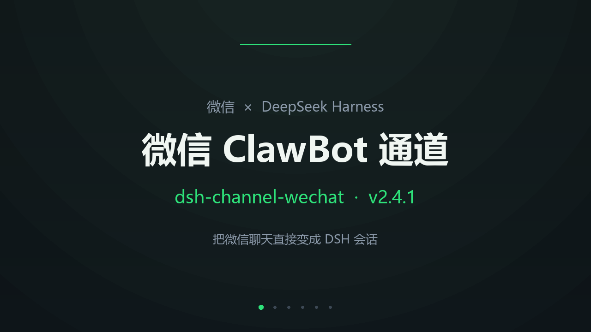

# 微信 ClawBot（iLink）通道 · DeepSeek Harness 插件

**中文** | [English](./README.en.md) · 版本 **2.14.0** · [更新日志](./CHANGELOG.md)

把 **DeepSeek Harness 的会话**和**微信（官方 ClawBot「龙虾」插件）**双向接起来：
微信里发消息 → 变成 DSH 会话里的用户消息；DSH 会话里的回复 → 发回微信。
支持多账号、每条微信聊天可绑定到任意一个 DSH 会话、Web GUI 里有一块专门的面板。

[](./docs/promo.mp4)

> 14 秒宣传片：[MP4 下载](./docs/promo.mp4) · [GIF](./docs/promo.gif)（点封面也能播）

> 不依赖 OpenClaw。微信 ClawBot 背后是腾讯的 iLink Bot 协议（HTTP/JSON），本插件直接实现它。

## 功能

- **双向镜像**：微信 ↔ 指定 DSH 会话。微信消息注入会话（GUI 里实时可见），助手的回复自动回微信；GUI 里输入的消息带 `[网页]` 前缀转发到微信。
- **多账号**：多个微信号（bot）同时在线，各自独立长轮询、独立游标、独立错误状态；单个账号可重扫码/断开而不影响其它账号。
- **绑定面板**：左侧栏「微信」→ 账号表（状态/最近错误/重扫码/断开）、扫码登录区（二维码 + 数字配对码）、绑定表（chat → 会话下拉框，选完立刻生效，可解绑/直接打开会话）。顶部还有「默认接收会话」选择器，决定以后新出现的微信聊天默认落到哪个会话，并可一键「新建会话并设为默认」。
- **token 消耗统计**：绑定表新增「消耗」列，主行是该会话的**计费 token（未缓存输入 + 输出）**，次行是「缓存读取 / 今日 / 上轮」（上下文缓存命中单列，不计入计费口径，避免把几亿缓存读取算成花费）；`/status` 也会显示「用量」一行（输入 / 输出 / 缓存读取三项），方便宿主了解每个微信用户花了多少。
- **发文件**：本地图片 / 视频 / 任意附件 → AES-128-ECB 加密 → 腾讯 CDN → 微信（图片走 `image_item`、视频走 `video_item`、其它走 `file_item`；单文件上限 50 MB）。
- **排版优化**：发到微信前统一把 Markdown 转成窄屏友好文本——表格变 · 键：值、标题变 【】、勾选框变 ✅/⬜、长段落按句读断行（列表续行缩进），宽度由 ormatMaxLine 控制。
- **任务进度播报**：wechat_report 把「标题 + 勾选清单（✅/🔄/⬜/⛔/⚠️）+ 备注」渲染成一条微信消息推给指定聊天；token 过期时自动进发送队列等补发。
- **跨账号转发**：多个微信号绑定同一个会话时，A 号收到的消息会自动转发到 B/C 号的微信（带 `[{account}] ` 前缀，可配 `relayPrefix`）；助手的回复本来就按绑定分别送达，所以三个号看到的是同一段对话。
- **微信引用**：在微信里长按「引用」某条消息（含只选中一段）再发问时，被引用的原文会以 `【引用】…` 的形式一起进入模型上下文。插件维护最近 800 条收发消息的引用库（`quotes.json`），客户端只给 `svr_id` 时也能按 id 还原原文，再按 `startindex/endindex` 截取选中片段。
- **选项 / 审批在微信里作答**：DSH 弹出 `ask_user_question` 选项卡或审批卡时，插件会把题目和选项同步发到绑定的微信：回序号（`1`、`1,3`）或直接回文字即可作答；审批回 `1`（允许一次）/ `2`（拒绝）。微信里等不到回复（默认 110 秒）就把这次请求交还电脑端弹卡，不会把会话卡死。由 `relayOptions` / `optionReplyTimeoutMs` 控制。
- **长任务进度提示**：绑定会话的一轮跑得久时，每隔 `progressIntervalMs`（默认 2 分钟）在微信里发一条「⏳ 还在处理：已经思考 X 分 Y 秒（第 N 次进度）」；如果这时正在等你回选项，会改成「⌛ 在等你回复：已经等了 X 分」。轮次结束自动停，不会刷屏。
- **微信里切换会话**：在微信里发 `/sessions` 看最近会话列表，`/use 2` 切到第 2 个，`/new` 开新会话，`/current` 看当前绑定；不在这几个命令里的 `/xxx` 照常发给会话。切换立即生效（不改电脑端任何东西），下一轮就发到新会话。
- **微信里换模型 / 看状态 / 停任务**：`/models` 列可用模型（标当前/默认、推理档），`/model 2`（或 `/model 2 high`、`/model provider/modelId`）切换会话模型；`/status` 看运行状态、队列与待输入；`/stop` 停掉当前这一轮。
- **微信里整理会话**：`/rename 标题` 给会话改名；`/history 6` 回看最近几条对话；`/search 关键词` 跨会话搜历史，搜到的序号可直接 `/use` 切过去；`/approval ask|never` 看/切当前会话的审批策略。
- **卖萌**：`cuteLevel` 控制助手回复句尾是否自动带一个 emoji/颜文字（默认 `subtle`，约一半回复带）；旧版 `/sticker` 与 `~/.dsh/wechat-stickers` 已废弃，统一用 `/emotion`。
- **表情包库 `/emotion`**：独立目录 `~/.dsh/wechat-emotions/`，按 **25 个细分分类**（开心/大笑/得意/害羞/爱你/亲亲/抱抱/感谢/庆祝/加油/冲鸭/摸鱼/困/难过/委屈/哭/生气/发火/无语/尴尬/惊讶/震惊/害怕/安慰/其他）存放图片与 GIF，带索引、重命名和备注；`/emotion add [分类]` 开始收录、接着发图、`/emotion end` 结束；`/emotion note 名字 备注` 会把备注拼进文件名；`/emotion other source true|false` 控制是否允许外来来源（默认 false）；发送前按语境做**本地关键词打分**（用户命中 2 分、助手回复命中 1 分），够分才发、每次最多 2 张、带冷却——全程不耗 token。启动时会把旧 `wechat-stickers` 里的图片一次性迁到「其他」（记为内置来源，原目录保留）。
- **思考片段摘要**（默认关，面板可开）：模型边想边把推理增量压成一句「💭 思考中：…」发到微信（本地截取、去代码块、按句号/上限截断，**不调模型不耗 token**）；同一会话默认 30 秒最多一条，`turn/end` 清空缓冲。
- **断联检测**：`/ping`（或 `/health`）在微信里直接查连接：每个账号是否在轮询、最近一次成功轮询多久前、最近错误、镜像与绑定数；snapshot 增加 `health` 供面板显示「连接正常/异常」。后台每 30 秒检查一次，长轮询超过 `healthStaleMs`（默认 120 秒）没成功就自动重启该账号的 monitor（记录 `staleRestarts`），不用手动重扫码；`healthCheck: false` 可关自动重启。
- **分段发送**（微信不支持流式，只能整段分条发）：长回复按空行段落切分、能合并的段合并、超长段再按句号/长度切，默认每条不超过 `segmentMaxChars`（0 = 用 `maxReplyChars`），相邻条之间隔 `segmentDelayMs`（默认 500ms）；可选 `segmentIndex: true` 加「（1/3）」序号；`segmentMode: length` 可回到旧的纯长度切分。
- **流式分段**（默认关，面板可开）：微信这一轮进行中时，按正文增量**边生成边发**——只在遇到空行（段落结束）且该段 ≥ `streamMinChars`（默认 200 字）时发送，两次至少间隔 `streamMinIntervalMs`（默认 1.5s）；最终回复会自动扣掉已发前缀，只补发剩余部分，不会重复。
- **建议入口**：微信里 `/suggest <内容>` 直接把需求提交成 GitHub issue（标题取首行、正文带聊天/账号/版本信息），成功后回复 issue 链接；同一聊天有冷却（`suggestCooldownMs`），token 支持插件配置 `suggestToken` 或环境变量 `GH_TOKEN` / `GITHUB_TOKEN`，可配 `suggestRepo` / `suggestLabels`。
- **风险消息邮件预警**（可选，默认关）：`riskAlert: true` 后，入站文本命中规则（内置赌博 / 诈骗刷单 / 色情 / 引流外链，可用 `riskPatterns` 覆盖）时，用 SMTP 给宿主发一封邮件（含时间、账号、聊天、命中的规则与原文片段），**消息照常转发、不拦截不改写**；同一聊天有 `riskCooldownMs` 冷却（默认 5 分钟）。`/risk` 查看状态，`/risk test` 发测试邮件。
- **自动化任务反馈**：定时任务（`schedule` 服务）投递到已绑定微信的会话后，这一轮结束时会往微信发一条 `⏰ 定时任务完成：「标题」· 用时 X`；通过任务的 `lastDelivery` 与 `turn/start` 时间窗口判断（默认前后 2 分钟），`automationReport: false` 可关。`/tasks`（`/schedule`）可直接查看当前定时任务列表。
- **热重载**：改完插件文件不用重启 DSH——微信里发 `/reload`（或 `POST /wechat-channel/reload`）会调用 DSH HMR 的 `reconcileProfile()`，重新读取 profile 里变化的插件文件并重启对应 entry；`hotReload: false` 可禁用。可选 `autoHotReload: true` 后每 30 秒检查 `index.js` 修改时间，变化后自动热重载（默认关，避免编辑到一半就重载）。客户端面板（`client.js`）属于浏览器 bundle，热重载后仍需刷新页面。
- **功能开关（面板）**：Web GUI「微信」面板底部有「功能开关」卡片，可勾选/取消**思考片段摘要、流式分段、自动表情、定时任务完成通知、进度心跳、风险消息邮件、自动热重载、输出文件转发**；改动立即生效并写入 `state.json`（`settings.features`），重启后保持。命令类功能（`/ping`、`/resend`、`/suggest`、`/tasks`、`/risk`、`/reload`、`/emotion`）始终可用。
- **输出文件转发**：AI 在会话里产出的文件会自动发到微信——包括助手消息里的 `image`/`file` 附件，以及回复文本里提到的本地文件（图片、视频、PDF、Office、压缩包、txt/md 等；`.js` 等源码不会自动发）；同一文件只发一次，超过 `mirrorFileMaxBytes`（默认 50MB）或解析失败会记日志并跳过。`mirrorFiles: false` 可关。
- **投递恢复**：发送失败（如 iLink `ret=-2 prepare failed`）的回复自动进补发队列（保留 `pendingTtlMs`，默认 6 小时），任一新消息带回 `context_token` 后**先自动补发**再处理新消息（并清除该账号的发送熔断）；`/resend` 可手动补发；连续 `sendBreakerThreshold` 次**真实回复**失败后熔断 `sendBreakerMs`（默认 5 分钟），进度/思考类附加消息**不参与熔断**、熔断期间静默跳过、失败日志每分钟最多一条；进度心跳失败会退避 2 分钟、不再刷屏；同一进程同一 stateDir 只保留一个活跃实例（防热重载泄漏出多个轮询/定时器）。
- **消息插进正在跑的对话**：会话正在跑时（不管是谁发起的），微信里新来的消息用 `steer` 直接插进**当前这一轮**，在下一个 step 边界被模型看到，不用等这一轮结束；会话空闲时才按普通一轮一答处理。插入会给一次「📥 已插入当前对话」回执（10 秒内多次插入只回一次）。
  - 「在跑」的判断：优先 `sessionController.state` 的真实 `running`，其次 `turn/start`・`turn/end` 跟踪；`turnActive` 只是运行时兜底标记，不写入 `state.json`，重启后按会话真实状态重新判断（避免上次没跑完的轮次被当成一直在跑）。
- **Agent 工具**：`wechat_login` / `wechat_verify_code` / `wechat_status` / `wechat_bind` / `wechat_unbind` / `wechat_send` / `wechat_send_file` / `wechat_report` / `wechat_logout` / `wechat_simulate` / `wechat_debug`。

## 安装

要求：DSH 桌面版（profile 装插件）+ 微信里启用官方 ClawBot 插件。

### 方式一：单文件安装器（推荐，一条命令）

`install.mjs` 自带全部逻辑：从本仓库拉取文件到 `<DSH_HOME>/plugins/dsh-channel-wechat`，用 `dsh plugin add` 链接进 profile，登记 bundle，并在 profile 的 `cordis.patch.yml` 里追加插件行。幂等、会留 `.bak` 备份。

```bash
# 在本仓库根目录
node install.mjs

# 指定 profile / 位置，或先看计划不动手
node install.mjs --profile web
node install.mjs --dry-run
```

也可以让任意 DSH 会话里的 agent 直接执行：把 `install.mjs` 交给它，它会自己跑完并提示重启。

### 自测

安装后可以跑一遍全功能自测（22 项，不发送微信消息）：```bash
DSH_WEB_URL=http://127.0.0.1:60260 node test-api.mjs
```n
### 方式二：用 DSH 的插件管理器

```text
plugin_manager: install_bundle  target=<本目录的绝对路径>
```

安装后：

1. 重启 DSH 桌面应用（客户端面板清单是启动时扫描的），刷新页面；
2. 左侧栏出现「微信」图标 → 点开 → 右上「新增账号」；
3. 手机微信扫码（可能还需要输入手机上的数字配对码）；
4. 微信里给机器人发一条消息，绑定表里就会多一行；
5. 选一个 DSH 会话点「绑定」——之后两边就是同一个对话了。

## 协议（iLink Bot）

| 用途 | 接口 |
| --- | --- |
| 扫码登录 | `POST /ilink/bot/get_bot_qrcode?bot_type=3` |
| 轮询扫码状态 | `GET /ilink/bot/get_qrcode_status?qrcode=…&verify_code=…` |
| 长轮询收消息 | `POST /ilink/bot/getupdates`（`get_updates_buf` 游标，服务端 hold ~35s） |
| 发消息 | `POST /ilink/bot/sendmessage`（必须回填入站消息的 `context_token`） |
| 打字状态 | `POST /ilink/bot/getconfig` + `POST /ilink/bot/sendtyping`（本插件未用） |

所有请求带 `iLink-App-Id` / `iLink-App-ClientVersion` / `AuthorizationType: ilink_bot_token` / `X-WECHAT-UIN`（随机 uint32 → 十进制 → base64）头，body 带 `base_info`。

协议细节参考腾讯官方包 [`@tencent-weixin/openclaw-weixin`](https://www.npmjs.com/package/@tencent-weixin/openclaw-weixin)（MIT）与社区逆向文档 [`weixin-ClawBot-API`](https://github.com/sintrb/weixin-ClawBot-API)。本仓库不含腾讯代码。

## 微信内命令

| 命令 | 作用 |
| --- | --- |
| `/sessions`（`/ls`、`/list`） | 列出最近 12 个会话（标题 · id 后 8 位，标出「运行中 / 当前」），并记住这次的序号 |
| `/use 2`（`/switch 2`） | 切到上次列表里的第 2 个；也可以直接 `/use <完整会话 id>` |
| `/new` | 换到一个全新会话（下一条消息开始新对话，原会话保留在电脑端） |
| `/current`（`/now`） | 显示当前绑定会话、是否在线、是手动绑定还是自动会话 |
| `/rename 标题`（`/title`） | 给当前会话改名（最多 60 字，随会话保存） |
| `/history 6`（`/hist`） | 看当前会话最近 N 条对话（默认 6，最多 20，每条截断 140 字） |
| `/search 关键词`（`/find`） | 跨会话搜历史，列出命中的会话与片段，序号可直接 `/use` 切过去 |
| `/approval`（`/policy`） | 看当前审批策略；`/approval ask` 需要时询问，`/approval never` 需要审批的操作直接拒绝 |
| `/emotion` | 表情包库：`add [分类]` / `end` / `cancel` / `list [分类]` / `send [分类\|名字]` / `rename 旧 新 [备注]` / `note 名字 备注` / `delete 名字` / `other source true\|false` |
| `/ping`（`/health`） | 检查微信连接：账号是否在轮询、最近一次成功轮询多久前、最近错误、镜像与绑定数 |
| `/resend` | 立刻补发队列里没发出去的回复（发送失败自动入队，最多保留 6 小时） |
| `/suggest <内容>` | 把需求提交成 GitHub issue，成功后回复链接 |
| `/risk`（`/risk test`） | 查看风险邮件预警状态 / 发测试邮件 |
| `/tasks`（`/schedule`） | 查看定时任务列表（完成后自动通知绑定微信） |
| `/reload` | 热重载插件（应用新文件，不用重启 DSH） |
| `/models` | 列出可用模型（按厂商分组编号，标出「当前 / 默认」和推理档），并记住这次的序号 |
| `/model` | 查看当前会话模型与默认模型 |
| `/model 2` | 切到上次 `/models` 列表的第 2 个模型；`/model 2 high` 同时指定推理档；也可 `/model <provider>/<modelId>` |
| `/status` | 会话状态：标题/id、在线与运行中、当前模型、队列条数与待输入（审批/提问）、工作目录、绑定方式 |
| `/stop` | 停止当前这一轮（只在有轮次在跑时可停；排队消息不受影响） |
| `/help`（`/?`） | 命令帮助 |

- 切换只改微信这边绑定哪个会话，不会影响电脑端已经打开的会话或历史。
- 正在回复的那一轮没结束时，`/use`、`/new` 会先提示等结束，避免把回复发到一半切走。
- 命令只在**整条消息**以 `/`（或全角 `／`）开头且命中上表时生效；其他 `/xxx` 照常作为文字发给当前会话，不影响 agent 自己的斜杠命令。
- 想切到的会话如果没打开，插件会用 `sessionController.resolveAgent` 尝试恢复；恢复不了（已归档、不在本机）会提示你先在电脑端打开。

## 配置

在 DSH profile 的 `cordis.patch.yml` 里覆盖 `channel-wechat` 这一行的 `config`：

| 字段 | 默认 | 说明 |
| --- | --- | --- |
| `enabled` | `true` | 总开关 |
| `allowFrom` | `[]` | 微信用户白名单（`xxxx@im.wechat`），空 = 不限制 |
| `cwd` | `''` | 自动会话的工作目录，空 = DSH 默认目录 |
| `agentPreset` | `''` | 指定 agent preset |
| `replyTimeoutMs` | `180000` | 单轮等待 agent 回复上限 |
| `formatMaxLine` | `60` | 发到微信前按句读断行的宽度（字符） |
| `maxReplyChars` | `1800` | 单条微信文本上限，超出拆条 |
| `messagePrefix` | `''` | 注入会话时给微信消息加的前缀 |
| `webMessagePrefix` | `'[网页] '` | GUI 消息转发到微信时的前缀 |
| `mirrorUserMessages` | `true` | 是否把 GUI 用户消息转发到微信 |
| `mirrorAssistantMessages` | `true` | 是否把助手回复镜像到微信 |
| `mirrorIntervalMs` | `1200` | 镜像扫描间隔 |
| `relayOptions` | `true` | 把 DSH 的选项卡 / 审批卡同步到微信并接受序号回复 |
| `optionReplyTimeoutMs` | `110000` | 微信里等选项/审批回复的时长 |
| `optionTimeoutMode` | `skip` | 超时行为：`skip` 跳过继续（选项卡标未作答、审批按拒绝），`handoff` 交还电脑端弹卡 |
| `progressHeartbeat` | `true` | 一轮跑得久时在微信里定期报进度（已思考多久） |
| `progressIntervalMs` | `120000` | 进度提示间隔，最短 30000 |
| `insertWhileBusy` | `true` | 会话在跑时把微信消息插进当前对话（steer）而不是排队等待 |
| `cuteLevel` | `subtle` | 回复句尾加 emoji 的强度：`off` / `subtle`（约一半）/ `always` |
| `cutePool` | 内置 10 个 | 可爱化回复用的 emoji / 颜文字池 |
| `emotionDir` | `''` | 表情包库目录，空 = `~/.dsh/wechat-emotions`（启动时建 25 个分类目录） |
| `migrateLegacyStickers` | `true` | 首次启动把旧 `~/.dsh/wechat-stickers` 迁到 emotion「其他」（原目录保留） |
| `emotionAuto` | `subtle` | 自动表情：`off` / `subtle`（语境够强）/ `always`（命中就发） |
| `emotionThreshold` | `2` | `subtle` 档的语境分数门槛（用户命中 2 分、助手命中 1 分） |
| `emotionCooldownMs` | `300000` | 同一聊天自动发表情的冷却 |
| `emotionAllowOtherSource` | `false` | 是否允许外来来源表情包（内置等）；`/emotion other source true` 可临时开 |
| `thinkingSummary` | `false` | 思考时把推理增量压成短摘要发微信（面板可开） |
| `thinkingSummaryIntervalMs` | `30000` | 同一会话两条摘要的最小间隔，最短 10000 |
| `thinkingSummaryChars` | `120` | 单条摘要最多多少字 |
| `healthStaleMs` | `120000` | 长轮询多久没成功算断联（最短 30000） |
| `healthCheck` | `true` | 断联时自动重启该账号的轮询 |
| `segmentMode` | `paragraph` | 分段方式：`paragraph`（按空行分段再按长度切）/ `length`（纯长度切） |
| `segmentMaxChars` | `0` | 每条消息字符上限，0 = 用 `maxReplyChars`（最短 200） |
| `segmentDelayMs` | `500` | 相邻两条之间的间隔（毫秒） |
| `segmentIndex` | `false` | 多条时是否加「（1/3）」序号 |
| `pendingTtlMs` | `21600000` | 补发队列保留时长（毫秒），过期才丢 |
| `sendBreakerThreshold` | `5` | 连续发送失败多少次后熔断暂缓 |
| `sendBreakerMs` | `300000` | 熔断后暂缓时长（毫秒） |
| `streamSegment` | `false` | 边生成边发完整段落（面板可开） |
| `streamMinChars` | `200` | 一个完整段落至少多少字才发 |
| `streamMinIntervalMs` | `1500` | 两次流式发送的最小间隔（毫秒） |
| `suggestRepo` | `TotoQWQ/dsh-channel-wechat` | `/suggest` 提交 issue 的仓库（owner/repo） |
| `suggestToken` | `''` | GitHub token；空则读环境变量 `GH_TOKEN` / `GITHUB_TOKEN` |
| `suggestLabels` | `['suggestion','from-wechat']` | 新 issue 的标签 |
| `suggestCooldownMs` | `60000` | 同一聊天提交建议的冷却 |
| `githubApiBase` | `https://api.github.com` | GitHub API 地址（测试/企业版可改） |
| `riskAlert` | `false` | 风险消息是否发邮件（只通知，不拦截） |
| `riskPatterns` | 内置 4 条 | 规则数组 `{name, pattern}`；留空用内置 |
| `riskEmailTo` / `riskEmailFrom` | `''` | 预警收件人 / 发件人 |
| `riskCooldownMs` | `300000` | 同一聊天预警冷却 |
| `riskSmtpHost` / `riskSmtpPort` | `''` / `465` | SMTP 服务器与端口（587 自动 STARTTLS） |
| `riskSmtpSecure` | `true` | 465 隐式 TLS；587 可设 false 走 STARTTLS |
| `riskSmtpUser` / `riskSmtpPass` | `''` | SMTP 账号（AUTH LOGIN） |
| `automationReport` | `true` | 定时任务完成时给绑定微信发通知 |
| `automationWindowMs` | `120000` | 判断「这一轮由定时任务触发」的时间窗口 |
| `hotReload` | `true` | 允许 `/reload` 触发热重载 |
| `mirrorFiles` | `true` | AI 输出文件（附件 + 文本路径）自动转发微信 |
| `mirrorFileMaxBytes` | `52428800` | 转发的文件大小上限（默认 50MB） |
| `autoHotReload` | `false` | 文件变化后自动热重载（每 30 秒检查） |
| `apiBase` | `https://ilinkai.weixin.qq.com` | iLink 服务地址 |

选项/审批的回复规则：

- 选项题：回 `1`、`2`… 选对应序号；多选回 `1,3`（中英文逗号、顿号都行）；回其他文字当作自定义答案。
- 审批：回 `1` 允许一次，回 `2` 拒绝；也可回「允许/同意/拒绝/OK/No」。
- 序号超出范围、单选题回了多个序号时会提示重回，不会把错误答案交给模型。
- 微信里超时未回（默认 110 秒）：默认**跳过继续**——选项卡按「未作答」交回（`selected: []`），审批按「拒绝」处理，这一轮照常往下走；要回到「交还电脑端弹卡」的老行为，把 `optionTimeoutMode` 设成 `handoff`。这样人不在电脑旁时，会话不会被一张等不到的卡卡住。

状态与凭据写在 `~/.dsh/wechat-bridge/state.json`（0600），日志在同目录 `bridge.log`。

## HTTP 接口（面板用，同源）

`/wechat-channel/status`、`/sessions`、`/qr.png`、`/login`、`/logout`、`/verify`、`/bind`、`/unbind`。
只监听本机回环地址。

## 已知限制

- 入站：文本直接交给模型；图片 / 文件 / 视频 / **语音**都会从 CDN 下载并 AES-128-ECB 解密，落盘到 `~/.dsh/wechat-bridge/inbound/`（文件保留原文件名，语音存 `.silk`），路径、体积、时长写进消息文本（图片可用 `read_image` 查看）。语音同时带腾讯转写文本，silk→wav 转码未做；单条媒体上限 100 MB；
- 群聊按 `group_id` 单独映射，回复发回发送者，未做 @ 处理；
- 一个微信号的 ClawBot 只能绑定一个网关实例，绑定过其它实例会返回 `binded_redirect`；
- token 失效（errcode `-14`）会停掉该账号轮询，需重扫码；
- 微信二维码约 2 分钟过期，最多自动刷新 3 次；
- 双向镜像意味着绑定会话里的内容都会发到微信，注意隐私。

## 排障

### 微信收不到消息（日志里 `ret=-2 prepare failed`）

iLink 的 `sendmessage` 用 **HTTP 200 + body 里的 `ret`** 表示业务失败，`-2 prepare failed` 通常是这条 bot 会话的发送上下文（`context_token`）过期或失效（例如网关重启过）。

插件的处理：

- 收到非 0 的 `ret` 会立刻报错，不再静默“成功”；
- 带 `context_token` 失败时，按官方插件做法退回不带 token 重试一次；
- 仍失败则把消息放进每聊天的**发送队列**（最多 20 条），60 秒退避重试，并在**下一次收到该用户的微信消息**（带来新 token）时自动补发；
- 队列长度与该聊天的 `lastError` 都可以在 `/wechat-channel/status` 的 `bindings[]` 里看到。

所以「微信突然收不到」时：让对方给机器人发一句话即可恢复投递；若仍不行，说明微信侧 ClawBot 绑定已失效，需要重新扫码。

### 面板卡顿

面板只轮询 `/wechat-channel/status`（3 秒，页面切到后台时暂停，内容未变不重渲染）；`/sessions` 只在打开面板和点「刷新」时读取，避免频繁扫描会话库。

## License

MIT，见 [LICENSE](./LICENSE)；第三方组件见 [THIRD-PARTY-NOTICES.md](./THIRD-PARTY-NOTICES.md)。
